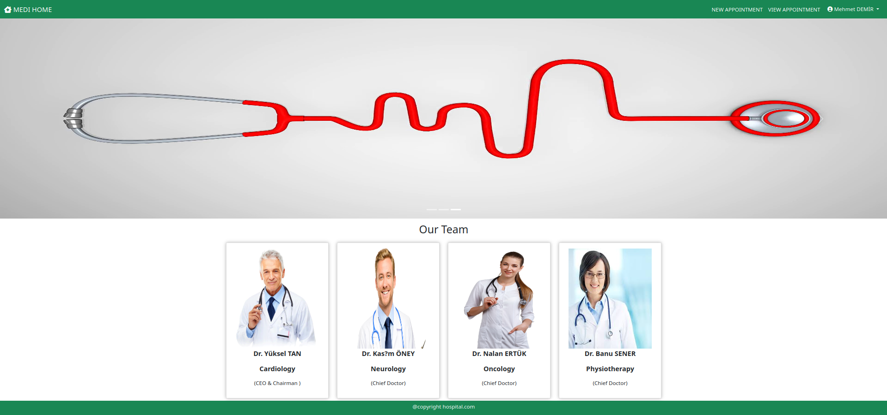
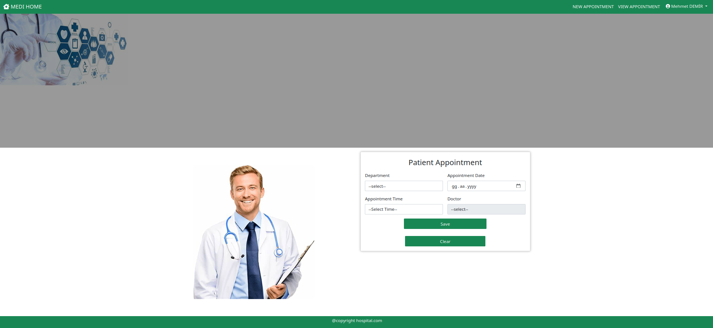
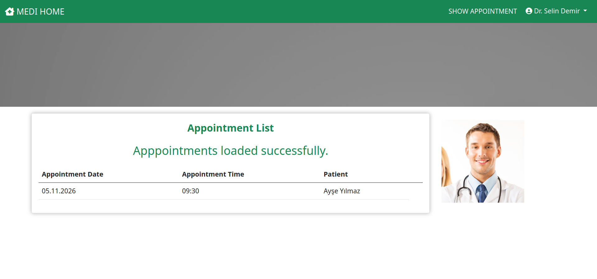
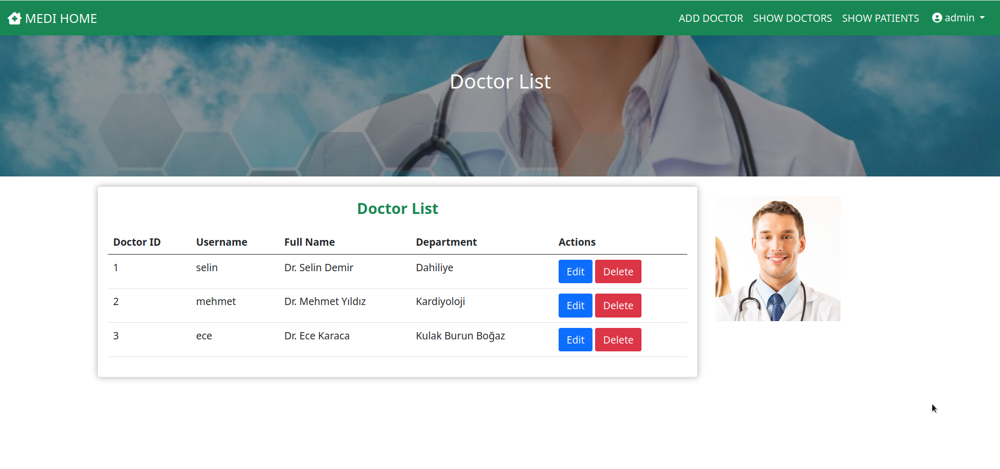
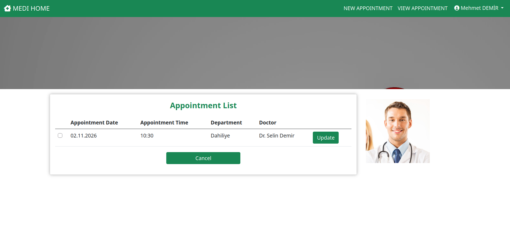
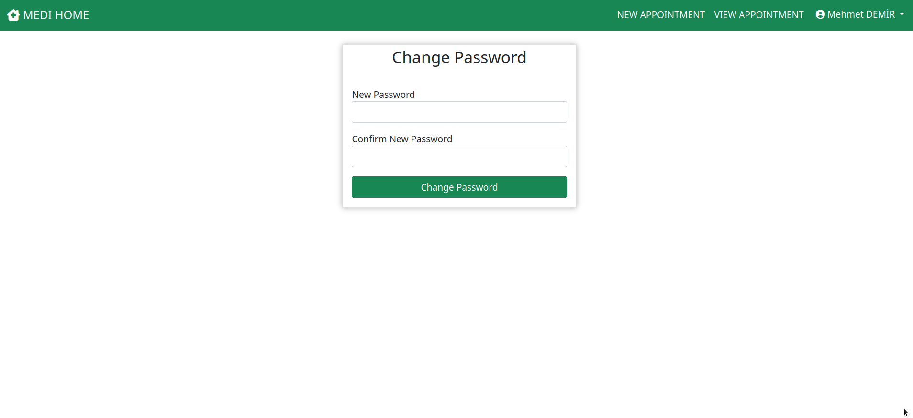
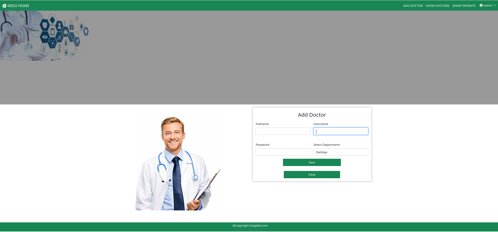
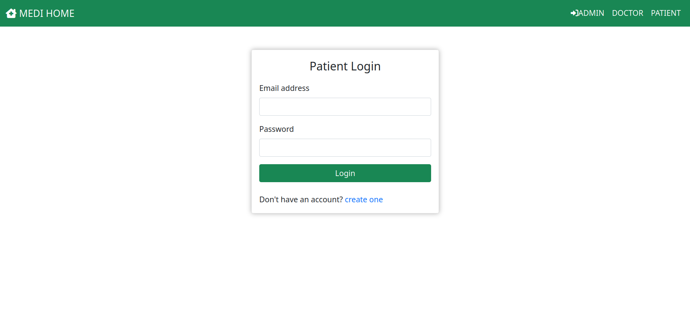
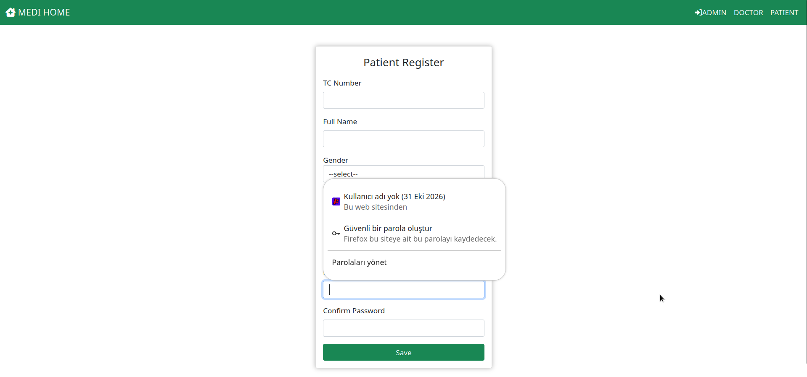

# Appointment
Hasta Randevu Sistemi

## Uygulamanın Amacı

Appointment, hastaların klinik bölümlerini ve doktorları inceleyip randevu oluşturmasını; doktorların kendilerine ait randevuları görüntülemesini; yöneticilerin ise doktor ve hasta kayıtlarını yönetmesini sağlayan web tabanlı bir hastane randevu sistemidir.

## Temel İşlevler

- **Hastalar:** Kayıt olabilir ve giriş yapabilir, bölüme ve doktora göre randevu alabilir, mevcut randevularını görüntüleyip güncelleyebilir veya iptal edebilir. Ayrıca parolalarını değiştirebilirler.
- **Doktorlar:** Giriş yaptıktan sonra kendilerine ait randevuları görüntüleyebilirler.
- **Yöneticiler:** Doktor ekleyebilir, doktor kayıtlarını görüntüleyip güncelleyebilir veya silebilir ve hasta listesini görüntüleyebilir.
- Randevu oluşturma akışında aynı hastanın aynı gün aynı bölüm için tekrar randevu alması ve dolu doktor saatinin seçilmesi engellenir.
- Uygulama verileri yerel geliştirme için H2 veritabanında saklanır; ilk çalıştırmada örnek bölümler, doktorlar, hasta ve randevu verileri oluşturulur.

Uygulama Java Servlet/JSP, JPA ve Maven kullanılarak geliştirilmiştir ve WAR olarak paketlenir.

## Screenshots

| Patient | Doctor | Admin |
|---|---|---|
|  |  |  |
|  |  |  |
|  |  |  |
|  |  | |

## Local run

Requirements:
- JDK 8 or newer
- Maven 3.8+

Run the project from the repository root:

```bash
mvn package
mvn jetty:run-war
```

Then open:

```text
http://localhost:8080/Appointment/
```

This project is configured to use an embedded H2 database for local development, so no external MySQL installation is required.

## Demo seed data

When the app starts, it inserts example data automatically if the database is empty:

- Departments: Dahiliye, Kardiyoloji, Kulak Burun Boğaz
- Doctors:
  - Dr. Selin Demir (username: selin, password: 123)
  - Dr. Mehmet Yıldız (username: mehmet, password: 123)
  - Dr. Ece Karaca (username: ece, password: 123)
- Patient sample: Ayşe Yılmaz (TC: 12345678901)
- Sample appointment is also created

Admin login remains:
- Username: admin
- Password: 123
